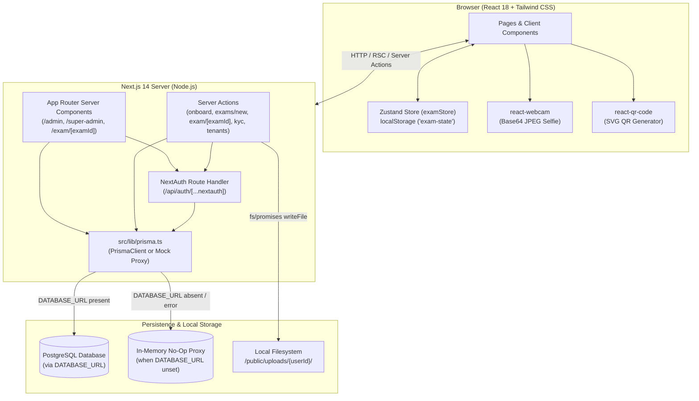
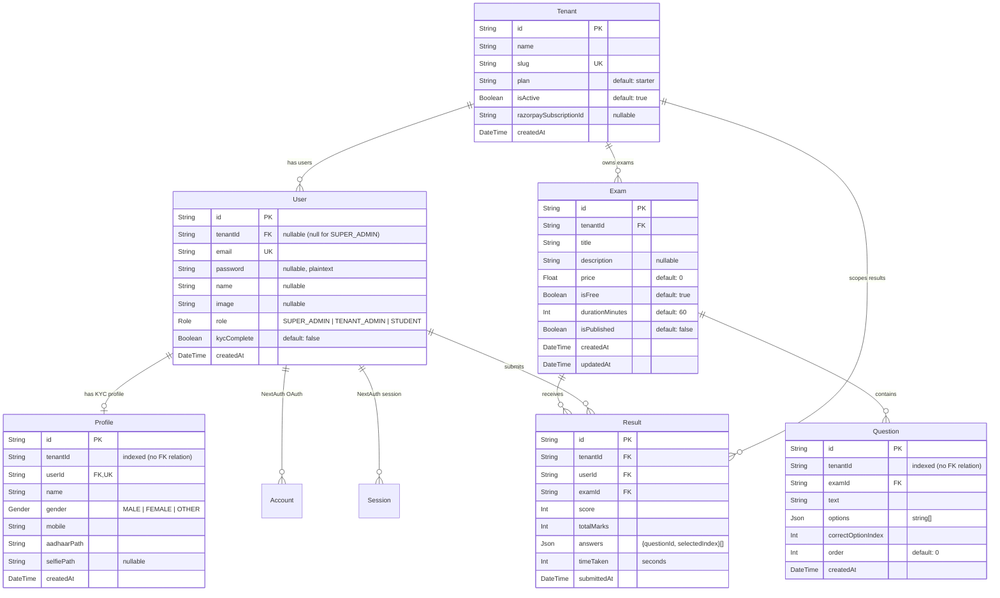
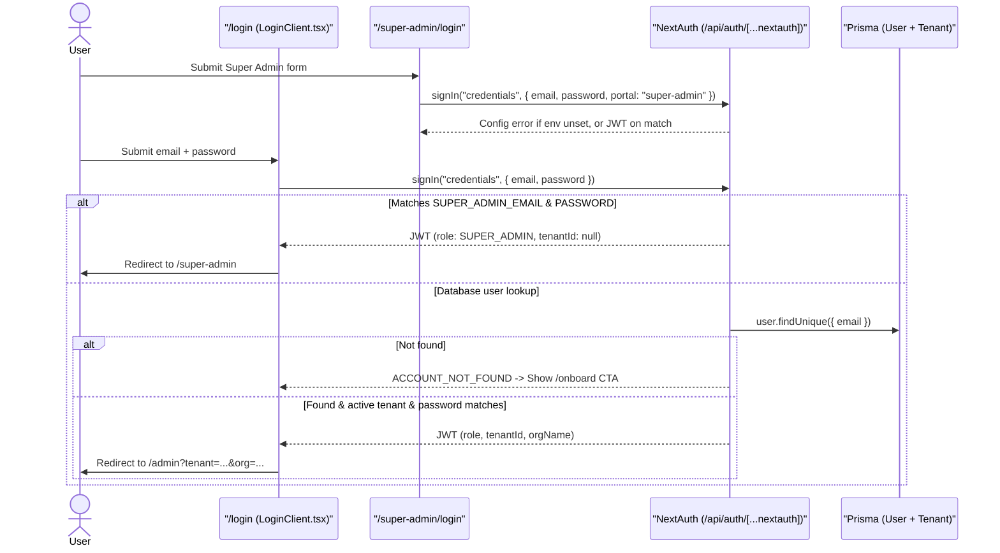
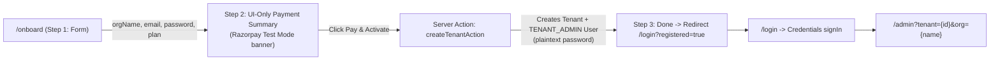
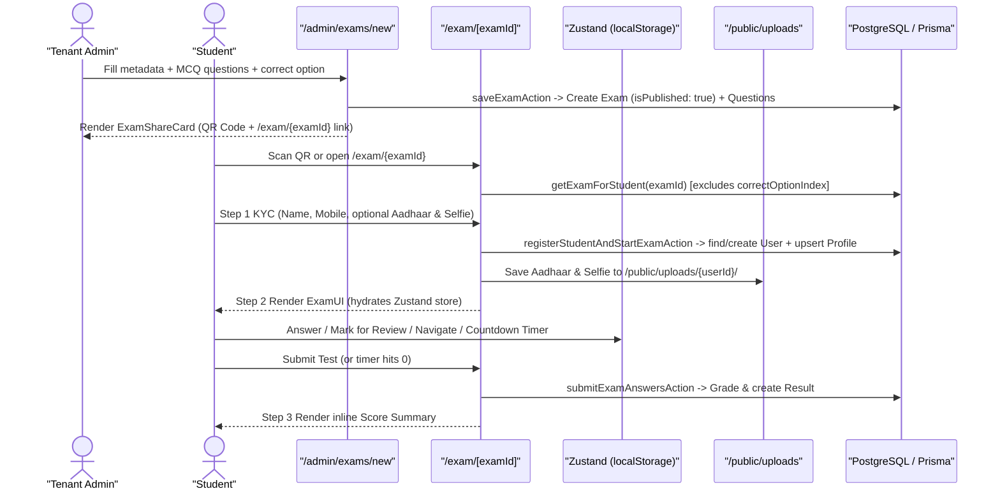

# Technical Architecture — LopyTech Exam Portal

> **Scope Note:** This document reflects the **actual inspected codebase** as of November 2026. Where the repository's planning notes (`PRD.md`, `Phases.md`, `Architecture.md`) differ from the source code, the source code is treated as the source of truth and discrepancies are explicitly flagged.

---

## 1. Project Overview & Technology Stack

**LopyTech Exam Portal** is a multi-tenant SaaS online examination platform built on **Next.js 14 (App Router)**. It is designed around three personas:

1. **Super Admin (Platform Owner):** Provisions and manages client organizations (tenants) and monitors platform-wide counts.
2. **Tenant Admin (Client / Institute):** Onboards an organization, creates multiple-choice exams, distributes shareable links/QR codes, and reviews student cohorts and exam submissions.
3. **Student (Examinee):** Enters an exam via a public share link/QR code, completes inline KYC (name, mobile, optional Aadhaar document & webcam selfie), takes the timed MCQ exam, and receives an instant score summary.

### Technology Stack

| Layer | Technology | Version (from `package.json`) | Actual Usage in Codebase |
|---|---|---|---|
| **Framework** | Next.js (App Router, Server Components, Server Actions) | `14.2.35` | Routing, SSR, Server Actions (`'use server'`), standalone output |
| **UI Library** | React / React DOM | `^18` | Server & Client Components |
| **Language** | TypeScript | `^5` | Strict mode (`"strict": true` in `tsconfig.json`) |
| **Styling** | Tailwind CSS + PostCSS | `^3.4.1` / `^8` | Utility-first styling; forced light color-scheme in `globals.css` & `layout.tsx` |
| **Icons** | `lucide-react` | `^1.72.0` | SVG iconography across all UI pages |
| **Authentication** | NextAuth.js (`next-auth`) + `@next-auth/prisma-adapter` | `^4.24.15` / `^1.0.7` | JWT session strategy; Credentials + Google OAuth provider config |
| **Database & ORM** | PostgreSQL + Prisma (`prisma`, `@prisma/client`) | `^6.19.3` | Relational persistence with in-memory Proxy mock fallback when `DATABASE_URL` is unset |
| **Client State** | Zustand (`zustand`) | `^5.1.0` | Exam-taking state (`useExamStore`) persisted to `localStorage` |
| **Forms & Validation** | `react-hook-form` + `@hookform/resolvers` + `zod` | `^7.92.0` / `^7.0.6` / `^4.6.7` | Form handling & schema validation on `/onboard`, `/admin/exams/new`, `/student/kyc` |
| **QR & Camera** | `react-qr-code` + `react-webcam` | `^2.2.0` / `^7.2.0` | Client-side SVG QR generation & browser webcam selfie capture |
| **Linting** | ESLint + `eslint-config-next` | `^8` / `14.2.35` | `next/core-web-vitals`, `next/typescript` |

> **Note on `shadcn/ui`:** Root `Architecture.md` mentions `shadcn/ui`, but **no shadcn/ui components, `components.json`, or Radix dependencies exist** in the repository. All UI elements are hand-written Tailwind HTML elements.

---

## 2. High-Level System Architecture

The application follows a **monolithic Next.js 14 App Router architecture** where Server Components and Server Actions communicate directly with PostgreSQL via Prisma (or the in-memory mock fallback in environments without `DATABASE_URL`). File uploads (Aadhaar documents and webcam selfies) are written directly to the local filesystem under `/public/uploads/`.



---

## 3. Complete Folder and File Structure

```text
/
├── .env.example                                  # Environment variable template (10 keys)
├── .eslintrc.json                                # Next.js core-web-vitals + TypeScript ESLint config
├── .gitignore                                    # Standard Next.js gitignore
├── next.config.js                                # Standalone output, Server Actions allowedOrigins, image domains
├── package.json                                  # Dependencies & npm scripts (dev, build, start, lint, postinstall)
├── postcss.config.mjs                            # Tailwind PostCSS plugin
├── tailwind.config.ts                            # Tailwind v3 content paths & CSS variable theme extension
├── tsconfig.json                                 # Strict TypeScript config with @/* -> ./src/* alias
│
├── prisma/
│   ├── schema.prisma                             # ACTIVE Prisma schema (PostgreSQL, 9 models, 2 enums)
│   └── prisma/
│       └── schema.prisma                         # STALE/DUPLICATE older schema (unused by Prisma CLI)
│
├── scripts/
│   ├── check_db.js                               # Utility script: counts/prints Tenant, User, Exam rows
│   └── clean_db.js                               # Destructive script: TRUNCATEs core tables CASCADE
│
├── public/
│   └── uploads/                                  # Local KYC upload storage (contains sample dev uploads)
│
├── design reference/                             # Static UI reference images (img.png, img1.png, img2.png)
├── docs/                                         # Generated technical & functional documentation
│   ├── Architecture.md
│   └── Documentation.md
├── Architecture.md, Design.md, Memory.md,        # Original planning & Vibe-coding context docs
│   PRD.md, PROJECT_STRUCTURE.md, Phases.md,
│   README.md, Rules.md
│
└── src/
    ├── lib/
    │   ├── auth.ts                               # NextAuthOptions (PrismaAdapter, Google + Credentials, JWT)
    │   └── prisma.ts                             # PrismaClient singleton + Mock Proxy fallback
    ├── store/
    │   └── examStore.ts                          # Zustand exam engine state + localStorage persistence
    ├── components/
    │   └── exam/
    │       ├── ExamShareCard.tsx                 # QR code + copyable share link card
    │       └── ExamUI.tsx                        # 70/30 desktop split & mobile drawer exam player
    └── app/
        ├── favicon.ico
        ├── fonts/                                # GeistVF.woff, GeistMonoVF.woff
        ├── globals.css                           # Tailwind base + forced light input styling overrides
        ├── layout.tsx                            # Root layout, Geist fonts, forced light color-scheme metadata
        ├── page.tsx                              # Default create-next-app landing page (unmodified boilerplate)
        │
        ├── api/auth/[...nextauth]/route.ts       # NextAuth GET/POST route handler
        │
        ├── (auth)/login/
        │   ├── page.tsx                          # Server check: redirects active sessions; renders LoginClient
        │   └── LoginClient.tsx                   # Email/password form + onboard/super-admin links
        │
        ├── (tenant)/onboard/
        │   ├── page.tsx                          # 3-step client self-onboarding (form -> UI-only payment -> done)
        │   └── actions.ts                        # createTenantAction: creates Tenant + TENANT_ADMIN User
        │
        ├── (dashboard)/
        │   ├── admin/
        │   │   ├── page.tsx                      # Tenant Admin overview metrics & recent exams list
        │   │   ├── exams/new/
        │   │   │   ├── page.tsx                  # Server wrapper passing tenantId to ExamBuilderClient
        │   │   │   ├── ExamBuilderClient.tsx     # Dynamic MCQ exam builder -> ExamShareCard on save
        │   │   │   └── actions.ts                # saveExamAction, publishExamAction
        │   │   ├── students/
        │   │   │   ├── page.tsx                  # Fetches STUDENT users for tenantId
        │   │   │   └── StudentsTableClient.tsx   # Search & KYC status filter table
        │   │   └── results/
        │   │       ├── page.tsx                  # Fetches Result rows + Exam list for tenantId
        │   │       └── ResultsTableClient.tsx    # Search, exam filter & column sorting table
        │   └── student/
        │       ├── kyc/
        │       │   ├── page.tsx                  # Renders KycClient
        │       │   ├── KycClient.tsx             # Legacy 2-step KYC (Personal Info + Aadhaar + Selfie)
        │       │   └── actions.ts                # saveKycAction: writes files to /public/uploads, upserts Profile
        │       └── exam/[examId]/
        │           ├── page.tsx                  # Authenticated/demo exam route (redirects to missing results route)
        │           └── actions.ts                # submitExamAction: scores & redirects to /student/results/[id]
        │
        ├── exam/[examId]/
        │   ├── page.tsx                          # Public exam entry (supports 'demo' fallback or DB exam)
        │   ├── PublicExamClient.tsx              # 3-stage public flow: inline KYC -> ExamUI -> Score Summary
        │   └── actions.ts                        # getExamForStudent, registerStudentAndStartExamAction, submitExamAnswersAction
        │
        └── super-admin/
            ├── login/page.tsx                    # Super Admin login form (NOTE: calls wrong provider ID)
            ├── page.tsx                          # Platform metrics + tenant table
            └── tenants/
                ├── new/
                │   ├── page.tsx                  # Create tenant form
                │   └── actions.ts                # createTenantBySuperAdminAction
                └── [id]/
                    ├── page.tsx                  # Tenant detail view (users, exams, submission count)
                    ├── TenantManageClient.tsx    # Plan selector, activate/deactivate, delete controls
                    └── actions.ts                # toggleTenantStatusAction, updateTenantPlanAction, deleteTenantAction
```

---

## 4. Frontend Architecture

### Component & Rendering Strategy
- **Server Components by Default:** All `page.tsx` routes are Server Components (except `/onboard/page.tsx`, `/super-admin/login/page.tsx`, and `/super-admin/tenants/new/page.tsx`, which are marked `'use client'`).
- **Client Leaf Components (`*Client.tsx`):** Interactive forms, tables, webcam capture, QR display, and the exam execution interface live in `'use client'` modules.
- **Root Layout & Styling (`src/app/layout.tsx`, `src/app/globals.css`):**
  - Loads local variable fonts `GeistVF.woff` and `GeistMonoVF.woff` via `next/font/local`.
  - Forces light mode (`color-scheme: only light`, `className="light"`, and `!important` CSS rules on `input`, `textarea`, `select`, and `:-webkit-autofill`) to prevent mobile dark-mode contrast issues.
  - Uses Tailwind v3 utility classes (`slate-*`, `emerald-*`, `green-*`, `purple-*`, `rose-*`, `amber-*`).

### Client State Management (`src/store/examStore.ts`)
- Built with **Zustand** (`create` + `persist` middleware using `localStorage` under key `'exam-state'`).
- Exclusively manages exam-taking state:
  - `examId: string | null`
  - `currentQuestionIndex: number`
  - `timeRemaining: number` (seconds)
  - `questionStatuses: Array<{ id: string; status: 'NOT_VISITED' | 'ANSWERED' | 'MARKED_FOR_REVIEW'; selectedOptionIndex: number | null }>`
- **Hydration Behavior:** `hydrateExam(examId, questionIds, durationSeconds)` skips resetting state if `existing.examId === examId && existing.questionStatuses.length > 0`, allowing reload resumption.

### Exam UI Architecture (`src/components/exam/ExamUI.tsx`)
- **Desktop (`md:` and up):** Sticky top header (student name, countdown timer, exam title) + `70% / 30%` CSS Grid:
  - Left 70%: Question card, radio option list (`min-h-[48px]`), Clear / Mark for Review / Previous / Save & Next buttons.
  - Right 30%: Sticky `QuestionPalette` (status legend counts, 5-column numbered grid color-coded green/slate/purple, "Submit Test" button).
- **Mobile (`< md`):** Sticky top header with `<LayoutGrid />` trigger, scrollable question + options, sticky two-row bottom action bar (Row 1: Clear + Review; Row 2: 40% Previous + 60% Save & Next), and a slide-up bottom sheet drawer for the `QuestionPalette`.

---

## 5. Backend Architecture

The backend consists entirely of **Next.js App Router Server Components**, **Next.js Server Actions**, and **one NextAuth API route**:

- **No REST/GraphQL API endpoints** exist for business entities (exams, tenants, students, results). All mutations happen through Server Actions (`'use server'`).
- **Database Access (`src/lib/prisma.ts`):**
  - Exports a global singleton `prisma` typed as `PrismaClient`.
  - When `process.env.DATABASE_URL` is absent (or `new PrismaClient()` fails), `prisma` evaluates to a `Proxy` returning async no-op stubs (`findMany -> []`, `findFirst/findUnique -> null`, `count -> 0`, `create -> { id: 'mock-...' }`, etc.) so pages and actions render without crashing.
- **File Uploads (`src/app/exam/[examId]/actions.ts`, `src/app/(dashboard)/student/kyc/actions.ts`):**
  - Uses Node's `fs/promises` (`mkdir`, `writeFile`) to store Aadhaar files (`aadhaar_<timestamp>_<sanitizedName>`) and decoded base64 selfies (`selfie_<timestamp>.jpg`) in `public/uploads/<userId>/`.
  - Paths like `/uploads/<userId>/<filename>` are saved to `Profile.aadhaarPath` and `Profile.selfiePath`.
- **Scoring Engine (`src/app/exam/[examId]/actions.ts`, `src/app/(dashboard)/student/exam/[examId]/actions.ts`):**
  - Server-side scoring loads `exam.questions` from PostgreSQL and counts `1` point per question where `selectedIndex === correctOptionIndex`.
  - In `submitExamAnswersAction`, if `exam` is not found in DB (e.g., `/exam/demo` or mock DB mode), it falls back to counting any non-null selection as 1 mark.

---

## 6. Database Architecture & Entity Relationships

Defined in `/prisma/schema.prisma` (`provider = "postgresql"`):

> **Note:** A stale schema file exists at `/prisma/prisma/schema.prisma` (lacking `Tenant.plan`, `Tenant.isActive`, `User.password`, and using a non-nullable `User.tenantId`). The active Prisma CLI target is `/prisma/schema.prisma`.

### Entity Relationship Diagram



### Schema Observations
- **Multi-tenancy:** Every model except `Tenant` and NextAuth adapter models (`Account`, `Session`, `VerificationToken`) includes a `tenantId` column with `@@index([tenantId])`. However, `Profile.tenantId` and `Question.tenantId` do not declare `@relation` foreign keys to `Tenant`.
- **Global Email Uniqueness:** `User.email` is globally `@unique` (not composite `@@unique([tenantId, email])`), which prevents the same email/student mobile (`<mobile>@exam.student`) from having separate `User` accounts across different tenants.
- **Cascade Deletes:** Deleting a `Tenant` cascades to `User`, `Exam`, `Result`, and transitively to `Profile` and `Question`.

---

## 7. Authentication and Authorization Architecture

### Implemented Auth Setup (`src/lib/auth.ts`)
- **Adapter & Session:** `PrismaAdapter(prisma)` with `session: { strategy: 'jwt' }`.
- **Providers:**
  1. `GoogleProvider`: Registered conditionally via `getGoogleOAuthConfig()` only when both `GOOGLE_CLIENT_ID` and `GOOGLE_CLIENT_SECRET` are configured. **Not wired into any login UI button.**
  2. `CredentialsProvider` (`id: 'credentials'`):
     - **Path A (Super Admin):** Reads `SUPER_ADMIN_EMAIL` and `SUPER_ADMIN_PASSWORD` via `getSuperAdminConfig()` (no hardcoded fallbacks). When `portal: 'super-admin'` is passed and env vars are unset, throws a clear configuration error.
     - **Path B (Database Users — Tenant Admin / Student):** Queries `prisma.user.findUnique({ where: { email }, include: { tenant: true } })`. Throws `'ACCOUNT_NOT_FOUND'` if missing. Rejects missing `dbUser.password` or mismatches (`!dbUser.password || dbUser.password !== password`, plaintext). Rejects login if `dbUser.tenant && !dbUser.tenant.isActive`.
- **JWT & Session Callbacks:** Embeds `role`, `tenantId`, `orgName`, and `slug` in the JWT; attaches `id`, `role` (defaults to `'TENANT_ADMIN'`), `tenantId`, `orgName`, and `kycComplete` (hardcoded `true`) to `session.user`.

### Authentication Flow Diagram



### Authorization Enforcement Matrix (Actual Code State)

| Route / Action | Expected Role | Actual Server Enforcement in Code |
|---|---|---|
| `/super-admin`, `/super-admin/tenants/[id]` | `SUPER_ADMIN` | **Enforced:** `session?.user?.role !== 'SUPER_ADMIN'` redirects to `/super-admin/login` |
| `super-admin/tenants/*/actions.ts` | `SUPER_ADMIN` | **Enforced:** Checks `session?.user?.role !== 'SUPER_ADMIN'` |
| `/admin`, `/admin/students`, `/admin/results`, `/admin/exams/new` | `TENANT_ADMIN` | **MISSING:** Reads `searchParams.tenant` or `session?.user?.tenantId` with fallback `'demo-tenant'`; **no auth/role check** |
| `saveExamAction` (`admin/exams/new/actions.ts`) | `TENANT_ADMIN` | **MISSING:** Accepts `explicitTenantId` from client or falls back to latest/new tenant without requiring auth |
| `publishExamAction` (`admin/exams/new/actions.ts`) | `TENANT_ADMIN` | **Enforced** (checks `TENANT_ADMIN` + `tenantId`), but unused in UI |
| `/exam/[examId]` | Public (Student) | Intentionally public; no auth required |
| `/student/exam/[examId]` (legacy) | `STUDENT` | Checks `session?.user` + `tenantId` + `kycComplete` (except `'demo'`), redirects to missing `/student/results/[id]` on submit |

---

## 8. API Architecture & Endpoints

- **`/api/auth/[...nextauth]` (`GET`, `POST`):** The **only** HTTP API route in `src/app/api/`. Handled by `NextAuth(authOptions)` for sign-in, sign-out, `/api/auth/session`, CSRF token, and OAuth callbacks.
- All other backend interactions use **Next.js Server Actions** (`POST` requests to the originating route generated automatically by Next.js).

---

## 9. Main Application Workflows

### 9.1 Tenant Self-Onboarding & Login Flow


### 9.2 Exam Creation & Public Student Exam Flow


---

## 10. External Integrations

| Service | Status in Codebase | Notes |
|---|---|---|
| **PostgreSQL** | **Integrated (Optional at runtime)** | Connected via Prisma (`DATABASE_URL`). Falls back to in-memory no-op mock when `DATABASE_URL` is absent. |
| **Google OAuth (`next-auth`)** | **Configured only** | `GoogleProvider` registered in `src/lib/auth.ts`, but no Google sign-in button exists in UI and dummy fallback strings are set. |
| **Razorpay** | **UI / Schema Placeholder Only** | `Tenant.razorpaySubscriptionId` column and `.env.example` keys exist; `/onboard` displays a simulated "Razorpay Test Mode" button with zero Razorpay SDK/API calls. Paid exams (`Exam.isFree = false`) are not gated. |
| **Cloud Storage (S3 / GCS)** | **Not Implemented** | Comments mention future S3 migration; currently writes to `/public/uploads/`. |

---

## 11. Infrastructure & Deployment Architecture

- **Build & Runtime Config (`next.config.js`, `package.json`):**
  - `output: 'standalone'` configured for containerized Node.js deployment.
  - `dev` script binds to `0.0.0.0:3000` (`next dev -p 3000 -H 0.0.0.0`).
  - `postinstall` runs `prisma generate`.
  - `experimental.serverActions.allowedOrigins` allows `['localhost:3000', '*.run.app']`.
- **Ephemeral Filesystem Caveat:** Local uploads written to `/public/uploads/` will not persist across container restarts or horizontal scaling in stateless deployments (e.g., Cloud Run / standalone containers).
- **No CI/CD, Dockerfile, or Infrastructure-as-Code** files exist in the repository.

---

## 12. Security Architecture & Known Concerns

1. **Missing Auth & Tenant Isolation on `/admin/*`:** `/admin`, `/admin/students`, `/admin/results`, `/admin/exams/new`, and `saveExamAction` do **not** verify an authenticated `TENANT_ADMIN` session and accept `tenant` directly from URL query params / client arguments.
2. **Plaintext Password Storage:** `User.password` is still stored and compared in plaintext until password hashing is implemented (though hardcoded credential fallbacks and null-password bypasses have been eliminated in S1).
3. **Publicly Exposed KYC Documents:** Aadhaar uploads and selfies are saved inside `/public/uploads/`, making sensitive PII documents directly downloadable over HTTP without authentication.
6. **Unimplemented Payment Gate:** Exams marked `isFree: false` with a `price` can be accessed and submitted without payment verification.
7. **Unverified `tenantId` Scoping on Student Mobile Registration:** `registerStudentAndStartExamAction` queries `user.findFirst({ where: { email: '${mobile}@exam.student' } })` globally rather than scoping to `tenantId`, risking cross-tenant student collisions.

---

## 13. Important Architectural Decisions & Technical Limitations

- **Decisions Made by Original Authors:**
  - Dual student flows exist: a newer frictionless public route (`/exam/[examId]`) and a legacy authenticated route (`/student/kyc` -> `/student/exam/[examId]`).
  - Client-side `localStorage` persistence via Zustand ensures accidental refreshes during an active exam retain answers and remaining time.
  - Strict light-mode CSS overrides guarantee input legibility on mobile browsers with dark mode enabled.
- **Technical Limitations:**
  - **Initial-mount auto-submit edge case in `ExamUI.tsx`:** `useExamStore` initializes `timeRemaining: 0`. In `ExamUI.tsx`, the `useEffect` checking `if (timeRemaining === 0) handleSubmit()` runs in the initial render commit before `hydrateExam`'s state update triggers a re-render, which can immediately submit an empty exam if `'exam-state'` is not already in `localStorage`.
  - **Mock DB limitation:** When running without `DATABASE_URL`, the Prisma mock returns empty arrays/nulls without persisting newly created entities in memory across requests.
  - **Missing `/student/results/[id]` route:** The legacy student exam flow redirects to a non-existent results page.
  - **Demo scoring fallback:** `submitExamAnswersAction` awards 1 point for every answered option when the exam is not found in PostgreSQL (including `/exam/demo`).
